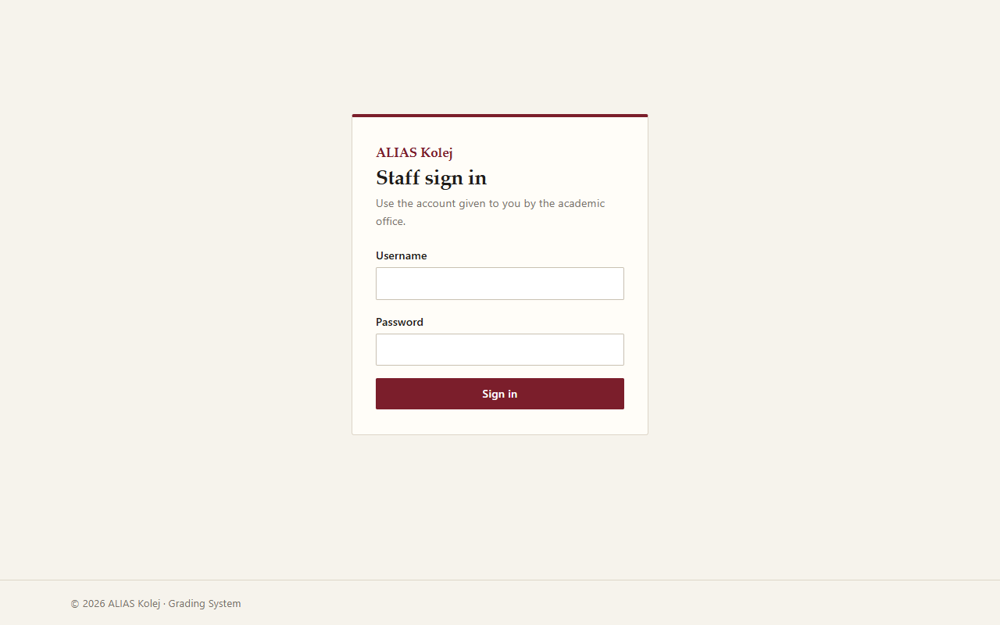
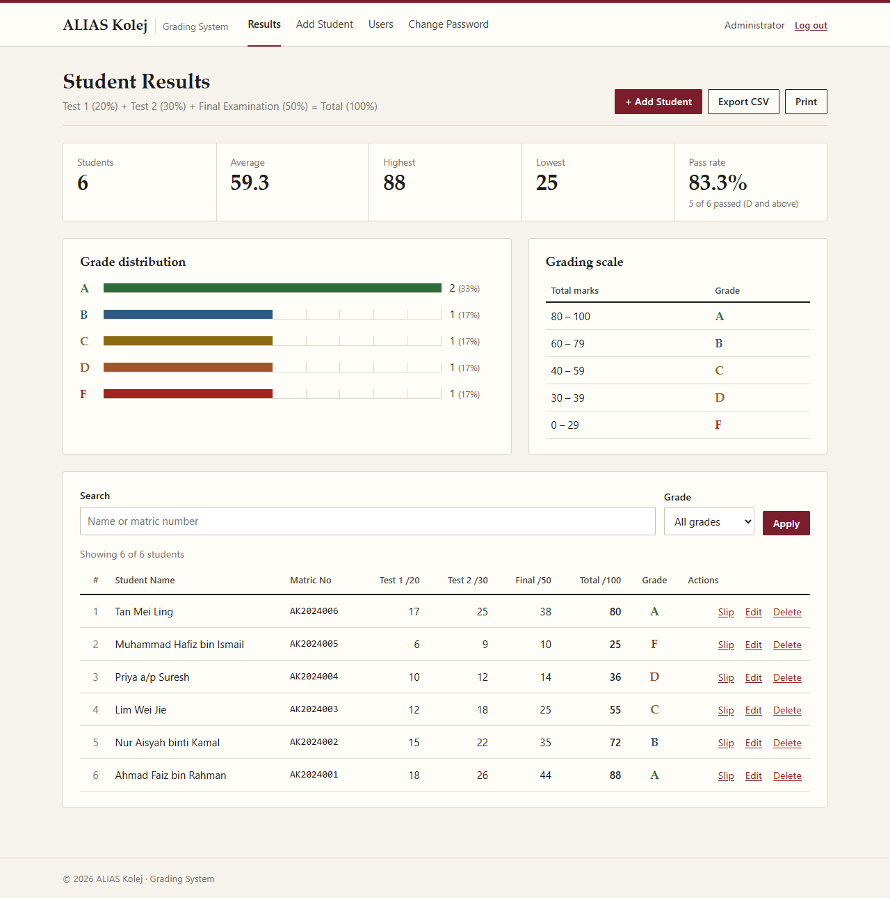
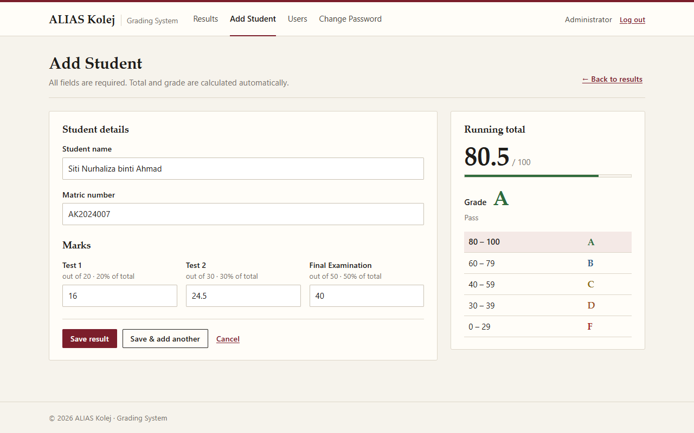
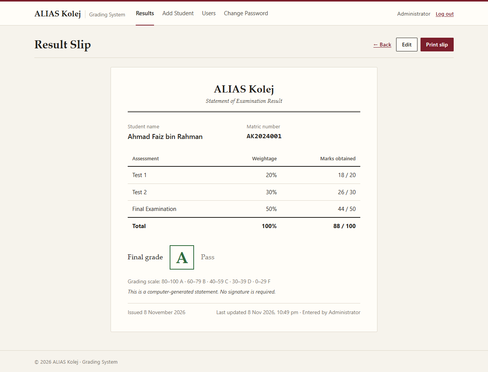

# ALIAS Kolej Grading System

A web app for recording student marks and working out final grades. It is built with PHP (PDO) and MySQL, uses plain CSS and JavaScript (no frameworks), and runs on XAMPP.

## Screenshots

| Login | Results |
|---|---|
|  |  |

| Add student (live preview) | Result slip |
|---|---|
|  |  |

## Features

- **Login** with `password_hash` / `password_verify` and PHP sessions. You must log in to open any page. Sessions time out after 30 minutes of inactivity, and there is a logout button.
- **Student result form** with these fields: student name, matric number, Test 1 (max 20 = 20%), Test 2 (max 30 = 30%) and Final Examination (max 50 = 50%).
  - Validation runs in the browser and again on the server. It checks required fields, mark limits and number format.
  - The matric number must be unique. The browser checks this as you type (AJAX), and the server and the database (`UNIQUE` key) check it again on save.
  - A live preview shows the total and grade while you type.
- **Results page** showing name, matric no, Test 1, Test 2, Final Exam, total and grade. It has:
  - search by name or matric number, a grade filter, and sorting by any column (click a column header)
  - summary cards for student count, average, highest, lowest and pass rate
  - a grade distribution chart drawn with CSS
  - edit, and delete with a confirmation prompt
  - CSV export (respects the current search, filter and sort) and a print view
- **Printable result slip** for each student.
- **User management**: add staff users, and change your own password.

### Grading scale

| Total marks | Grade |
|---|---|
| 80 – 100 | A |
| 60 – 79 | B |
| 40 – 59 | C |
| 30 – 39 | D |
| 0 – 29 | F |

Total = Test 1 + Test 2 + Final Examination (out of 100). Grades D and above count as a pass in the pass-rate card.

### Security

- Every query uses PDO prepared statements. Sort columns come from a fixed whitelist.
- Every form has a CSRF token, including login, logout, delete and change password.
- All output is escaped with `htmlspecialchars`. CSV cells are protected against formula injection.
- The session ID is regenerated on login, and session cookies are `HttpOnly` with `SameSite=Lax`.
- Login failures always show the same generic "Invalid username or password" message.
- `.htaccess` files block web access to `includes/`, `database.sql` and `README.md`.

## Requirements

- XAMPP with PHP 7.4 or newer (PHP 8.x recommended) and MySQL/MariaDB
- The `pdo_mysql` and `mbstring` PHP extensions (both are on by default in XAMPP)

## Setup on XAMPP

1. **Copy the project** into XAMPP's web folder, for example:
   ```
   C:\xampp\htdocs\grading\
   ```
2. **Start Apache and MySQL** in the XAMPP Control Panel.
3. **Create the database**:
   - Open <http://localhost/phpmyadmin>.
   - Click **Import**, choose `database.sql` from the project folder, and click **Import** (or **Go**).
   - This creates the `alias_grading` database, its tables, the default admin account and 6 sample students.

   You can also do this from a terminal:
   ```
   C:\xampp\mysql\bin\mysql -u root < database.sql
   ```
4. **Check the database settings** in `config.php`. The defaults match a fresh XAMPP install (`root` with an empty password):
   ```php
   define('DB_HOST', '127.0.0.1');
   define('DB_NAME', 'alias_grading');
   define('DB_USER', 'root');
   define('DB_PASS', '');
   ```
5. **Open the app** at <http://localhost/grading/> and log in with:

   | Username | Password |
   |---|---|
   | `admin` | `admin123` |

   Change this password straight away on the **Change Password** page.

> Re-importing `database.sql` drops and recreates the tables, so all existing data is lost.

## Project structure

```
├── index.php             Results page: summary cards, chart, search/filter/sort, table
├── student_form.php      Add / edit a student result (with live preview)
├── delete.php            Deletes a result (POST + CSRF only)
├── slip.php              Printable result slip for one student
├── export.php            CSV download (uses the current filters)
├── check_matric.php      JSON endpoint for the live matric uniqueness check
├── users.php             List users and add a new user
├── change_password.php   Change your own password
├── login.php / logout.php
├── config.php            Database settings
├── database.sql          Schema, default admin, sample data
├── includes/
│   ├── bootstrap.php     Session, PDO, CSRF, escaping, auth, validation, grading rules
│   ├── header.php        Shared page header and navigation
│   └── footer.php
└── assets/
    ├── style.css         All styles (including print styles)
    └── app.js            Client-side validation, live preview, confirmations
```

## Troubleshooting

- **"Database connection failed"**: make sure MySQL is running in XAMPP, `database.sql` has been imported, and the details in `config.php` are correct.
- **"Invalid or expired form token"**: the page was open for too long or the session expired. Refresh the page and try again.
- **Port conflicts**: if MySQL runs on a port other than 3306, change `DB_PORT` in `config.php`.
